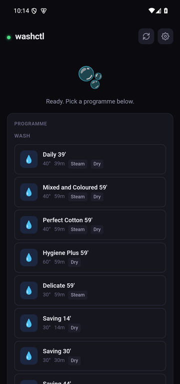
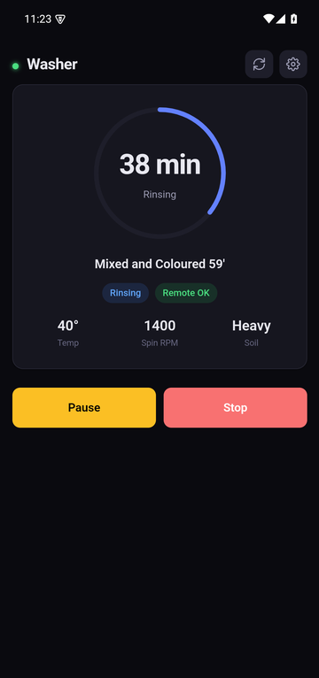

<p align="center">
  
</p>

<h1 align="center">simply-Fi-web</h1>

<p align="center">
  Local control for Candy Simply-Fi Wi-Fi washer-dryers: a web app and an Android app that talk
  to the machine directly on your home network, without the Candy cloud.
</p>

<p align="center">
  
  &nbsp;
  
</p>

## Features

- Live status: phase, remaining time, temperature, spin, drying and options
- Start any programme with temperature, spin, intensity, drying, steam, options and delayed start
- Stop, plus pause and resume on wifible models
- Favourites for your usual settings
- Finds the washer again if its IP changes (UDP broadcast, then a LAN scan)
- Checks that the washer actually started, and explains why when it didn't (for example,
  remote control switched off because the door was opened)
- Both command sets the Candy app uses: **dual** and **wifible** (see
  [Tested hardware](#tested-hardware))

## How it works

The washer runs a small HTTP server on port 80. Commands and status replies are `key=value`
strings XOR-encrypted with a 16-character per-appliance key and sent as hex:

```
GET http://<washer-ip>/http-read.json?encrypted=1                → status
GET http://<washer-ip>/http-write.json?encrypted=1&data=<HEX>    → command
```

The key is created when the washer is paired with the official app and stored in your Candy
account. [`bootstrap.py`](bootstrap.py) logs in to that account once to fetch it. After that,
everything stays on your LAN.

The full protocol write-up, recovered from the official Android app, is in
[`docs/protocol.md`](docs/protocol.md), with every writable parameter in
[`docs/commands.json`](docs/commands.json).

## Getting started

### 1. Get your washer's key

Requires Python 3.10+ and a Candy (Simply-Fi) account with the washer already paired.

```sh
pip install httpx playwright && playwright install chromium
python3 bootstrap.py --save
```

It asks for your Candy account email and password (or reads `CANDY_EMAIL` / `CANDY_PASSWORD`
from a `.env` file next to the script), lists your appliances, finds the washer on your network
and writes two local files:

- `web/config.json`: the washer's IP, encryption key, protocol and MAC
- `web/my_programmes.json`: your washer's real programme list

Both are gitignored. Without `--save` it only prints the key.

### 2a. Web app

```sh
web/run.sh            # → http://localhost:8420, also reachable from your phone's browser
```

### 2b. Android app

Download the APK from [Releases](../../releases), install it, and enter the washer's IP, key and
protocol on the settings screen. The release build uses the demo programme tables for your
protocol.

To build it yourself with your own programme list and settings included, see
[`android/README.md`](android/README.md).

### Remote control on the washer

The washer only accepts commands while remote control is enabled **on the machine itself**.
Opening the door switches it off. Close the door and turn remote control back on at the washer
before starting a cycle from the app; the app tells you when it's off.

## Tested hardware

Developed and tested on a **Candy CSOW 4855TWE/1-S** washer-dryer (Smart Pro). The Candy cloud
reports it as:

| Field | Value |
|---|---|
| `appliance_type` | `washer_dryer` |
| `interface_type` | `SMARTPRO_5DIG_STM_NEL` |
| `connectivity` | `wifible` |
| Command set that works | **dual** (with `PrCode` sent) |

So despite the "wifible" connectivity, this model takes the **dual** command set. The
**wifible** command set is implemented from the official app's code but hasn't been tested on a
real machine yet.

## Contributing

Contributions that make this work with other Candy, Hoover or Haier washers and washer-dryers are
very welcome, whether that's a fix, a new programme table, or just a report that your model
works (or doesn't). Useful things to include in an issue or pull request:

- Your model and the `Type`, `Connectivity`, `Interface` and `Protocol` lines that
  `python3 bootstrap.py` prints (leave out the serial, MAC and key)
- Which protocol setting works for starting a cycle, and anything that behaves differently
- A status reply from the washer (`http-read.json`, decrypted), with the MAC removed

## Repository layout

```
bootstrap.py        fetch your washer's key and programme list from the Candy cloud (one-off)
web/                web app: FastAPI server (server.py) + single-page UI (static/index.html)
  candy_crypto.py   protocol: encryption, command builders, status decoder (self-test included)
  discover.py       finds the washer on the LAN
  programmes.json   demo programme tables for both protocols, used when you have no own list
android/            Android app (Kotlin + WebView, reuses the web UI)
docs/               protocol write-up and command reference
```

## License

[MIT](LICENSE)

## Disclaimer

This is an independent project. It is not affiliated with or endorsed by Candy, Hoover or
Haier. "Candy" and "Simply-Fi" are trademarks of their owners. Starting a washer remotely is
at your own risk: check the drum and door before you start a cycle.
